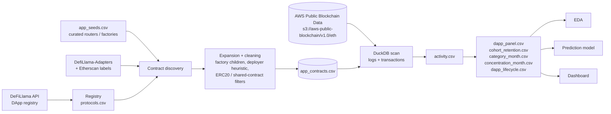

# Ethereum DApp Trend Analysis and Prediction

An end-to-end data engineering and analytics pipeline that measures **real usage of Ethereum DApps** (not just token hype), builds a DApp × month panel dataset from raw on-chain data, and uses it to analyze market concentration, category growth, and DApp lifecycles, with a predictive model for growing vs. flash-in-the-pan applications.

> Capstone project. Built on public data only: DeFiLlama, AWS Public Blockchain Data (Parquet on S3), and open-source adapter/label repositories. No BigQuery or GCP account required.

---

## Table of Contents

- [Why this project](#why-this-project)
- [Research questions](#research-questions)
- [Architecture](#architecture)
- [Repository structure](#repository-structure)
- [Data sources](#data-sources)
- [Methodology](#methodology)
- [Quickstart](#quickstart)
- [Outputs](#outputs)
- [Scale and performance](#scale-and-performance)
- [Attribution caveats](#attribution-caveats)
- [v1 vs. v2](#v1-vs-v2)
- [Roadmap](#roadmap)

---

## Why this project

Most DApp analytics track governance-token transfers or TVL. Those are poor proxies for adoption: a token can trade heavily while almost nobody uses the app, and many successful apps (NFT marketplaces, naming services, games) have no token at all.

This project instead attributes on-chain activity to **application contracts** (routers, pools, vaults, markets, factories) using event logs plus direct calls, then aggregates that activity into a clean panel suitable for time-series analysis and machine learning.

## Research questions

| # | Question | Answered by |
|---|----------|-------------|
| 1 | How concentrated is activity among the largest applications? | `concentration_month.csv` |
| 2 | Which categories of DApps are growing or declining? | `category_month.csv` |
| 3 | How quickly do successful DApps acquire users? | `dapp_lifecycle.csv` (`months_to_1k`, `months_to_10k`, `months_to_half_peak`, `wallets_m3/m6/m12`) |
| 4 | What patterns distinguish growing vs. flash apps? | `dapp_lifecycle.csv` (`lifecycle_label` + `early_*` features) and `cohort_retention.csv` |

## Architecture



## Repository structure

```
.
├── app_seeds.csv                  # Curated app contracts (routers, factories, markets) keyed by DeFiLlama slug
├── build_dapp_dataset_s3.py       # v1 pipeline: token-transfer based DApp dataset
├── build_dapp_dataset_v2.py       # v2 pipeline: application-contract based DApp panel (recommended)
├── map_all_tokens_to_apps.py      # Maps every token to the app / app contracts it belongs to
├── dapp_data/                     # v1 outputs (DuckDB + CSVs)
├── dapp_data_v2/                  # v2 outputs (registry, contract map, activity, panel, lifecycle)
├── eda/                           # Exploratory analysis
├── model/                         # Prediction modeling
└── dashboard/                     # Dashboard for exploring results
```

## Data sources

| Source | Used for |
|--------|----------|
| [DeFiLlama API](https://api.llama.fi/protocols) | DApp registry: names, categories, listing dates, TVL, parent protocols |
| `app_seeds.csv` (curated) | High-confidence routers, factories, and app contracts; also covers apps DeFiLlama does not list on Ethereum (OpenSea, ENS, CryptoKitties, etc.) |
| [DefiLlama-Adapters](https://github.com/DefiLlama/DefiLlama-Adapters) | Address extraction from TVL adapters (medium confidence) |
| [etherscan-labels](https://github.com/brianleect/etherscan-labels) (optional) | Name/label matching (low confidence) |
| [AWS Public Blockchain Data](https://registry.opendata.aws/aws-public-blockchain/) | Ethereum `transactions`, `logs`, and `contracts` tables as Parquet, queried in place via DuckDB over S3 |

## Methodology

**1. DApp registry.** Pull every Ethereum protocol from DeFiLlama, drop non-app categories (CEX, Chain, Bridge Aggregator), normalize categories into groups (DeFi, DEX, NFT, Gaming, Social, Infrastructure, Other), and resolve parent protocols so versions roll up to one app.

**2. Contract discovery.** Combine curated seeds, adapter-extracted addresses, and optional label matches. Each mapping carries a source and confidence level:

| Source | Confidence |
|--------|-----------|
| curated | high |
| factory | high |
| adapter | medium |
| label | low |
| deployer | low |

**3. Expansion and cleaning.**
- **Factory expansion:** scans `PairCreated` / `PoolCreated`-style events from curated factories to enumerate every child pool or pair.
- **Deployer expansion:** adds contracts created by deployers already tied to exactly one protocol.
- **Conflict resolution:** when multiple protocols claim a contract, the highest-priority source wins (curated > factory > adapter > label > deployer); conflicts are written to `contract_conflicts.csv` for audit.
- **Noise filters:** shared infrastructure (WETH, Permit2, Multicall) is denylisted; untrusted addresses claimed by 3+ protocols are dropped; ERC20s claimed by multiple protocols (USDC, DAI) are dropped, while single-app tokens, curated contracts, and factory pools are kept.

**4. Activity attribution.** Usage is attributed from event logs and direct calls, capturing router, aggregator, and smart-wallet users, not only EOAs calling the app directly.

**5. Panel and lifecycle features.** Aggregate to DApp × month, then derive cohort retention, category trends, concentration metrics, and lifecycle features (time to 1k / 10k wallets, time to half-peak, early-period features, and a growing vs. flash label).

**6. Token-to-app mapping.** `map_all_tokens_to_apps.py` builds a table mapping **all** tokens to the app they belong to, rather than a top-N subset.

## Quickstart

### Requirements

- Python 3.10+
- Network access to GitHub, DeFiLlama, and `s3://aws-public-blockchain` (public, anonymous access, no AWS credentials needed)

```bash
git clone https://github.com/anishwac0311/Ethereum-Dapp-Trend-Analysis-and-Prediction.git
cd Ethereum-Dapp-Trend-Analysis-and-Prediction

pip install duckdb pandas numpy requests
```

### Run a six-month sample (fast)

```bash
python build_dapp_dataset_v2.py \
  --start 2022-01-01 --end 2022-06-30 \
  --no-deployer-expansion --skip-labels
```

### Run the full history

```bash
python build_dapp_dataset_v2.py --start 2018-01-01 --end 2025-12-31
```

### Map all tokens to apps

```bash
python map_all_tokens_to_apps.py
```

### Updating curated seeds

`app_seeds.csv` slugs must match DeFiLlama slugs exactly. After editing it, delete the cached files so they rebuild:

```bash
rm dapp_data_v2/protocols.csv dapp_data_v2/discovered_raw.csv dapp_data_v2/app_contracts.csv
```

The pipeline is resumable: DuckDB tracks completed months, so re-running skips finished work and retries transient S3 errors automatically.

## Outputs

All v2 outputs are written to `dapp_data_v2/`.

| File | Description |
|------|-------------|
| `protocols.csv` | DApp registry with category groups and parent protocols |
| `app_contracts.csv` | Contract → DApp map with role, source, confidence, ERC20 flag, deploy date |
| `contract_conflicts.csv` | Contracts claimed by multiple protocols and how they were resolved |
| `activity.csv` | Attributed on-chain activity |
| `dapp_static.csv` | Static DApp attributes |
| `dapp_panel.csv` | DApp × month panel (the main modeling dataset) |
| `cohort_retention.csv` | Wallet cohort retention by DApp |
| `category_month.csv` | Category-level growth and decline over time |
| `concentration_month.csv` | Market concentration over time |
| `dapp_lifecycle.csv` | Lifecycle milestones, early features, and growing vs. flash label |
| `run.log` | Full run log |

## Scale and performance

- Roughly **2M rows** mapped across the contract/token mapping stage
- End-to-end runtime of about **6 hours**, including mapping
- Queries Parquet directly from S3 through DuckDB (no warehouse to provision), with retry/backoff on network errors and month-level checkpointing

## Attribution caveats

- A transaction touching N protocols credits each with the full gas of that transaction (see `n_protocols_in_tx`). Use gas to rank within an app; avoid summing it across apps for ecosystem totals without deduplication.
- Log-based attribution captures router, aggregator, and smart-wallet users but is several times more expensive to scan than transactions alone.
- Address-to-app mapping is heuristic below the `curated` and `factory` tiers. Use the `confidence` column to filter when precision matters.

## v1 vs. v2

| | v1 (`build_dapp_dataset_s3.py`) | v2 (`build_dapp_dataset_v2.py`) |
|---|---|---|
| Usage signal | Governance-token transfers | Application-contract activity (logs + direct calls) |
| Covers token-less apps | No | Yes (NFT marketplaces, naming, games, etc.) |
| Contract discovery | Token address only | Curated seeds, factories, adapters, labels, deployers |
| Conflict handling | None | Source priority + audit file |

## Roadmap

- [ ] Finalize and benchmark the growing vs. flash prediction model
- [ ] Publish dashboard views for concentration, category trends, and lifecycles
- [ ] Extend seed coverage to more non-DeFiLlama apps
- [ ] Add tests and a sample dataset for reproducibility
