# DApp v2 EDA Findings

**Data:** `dapp_data_v2/` (panel 2020-01 → 2025-12, 622 DApps with activity, 676 in static)  
**Scripts:** `eda/01_*.py` … `eda/06_*.py` — re-run with `python eda/run_all.py`  
**Outputs:** `eda/figures/`, `eda/figures/html/`, `eda/tables/`

---

## Headline observation: most adopted DApps flash, then fade

Trajectory clustering on **peak-normalized** monthly active wallets (launch-aligned, first 24 months) for 170 adopted DApps (peak ≥ 1k wallets, ≥ 12 months follow-up, not left-censored) yields a dominant shape:

| Cluster | Name | n | Pattern |
|---------|------|---|--------|
| 1 | **flash_fade** | **115 (68%)** | Peak ~month 3, then collapse to ~6% of peak by months 19–24 |
| 0 | slow_build | 50 (29%) | Quiet early, peak late (~month 22), still ~60% of peak at horizon |
| 2 | slow_build_sparse | 5 (3%) | Similar late peak, thinner path |

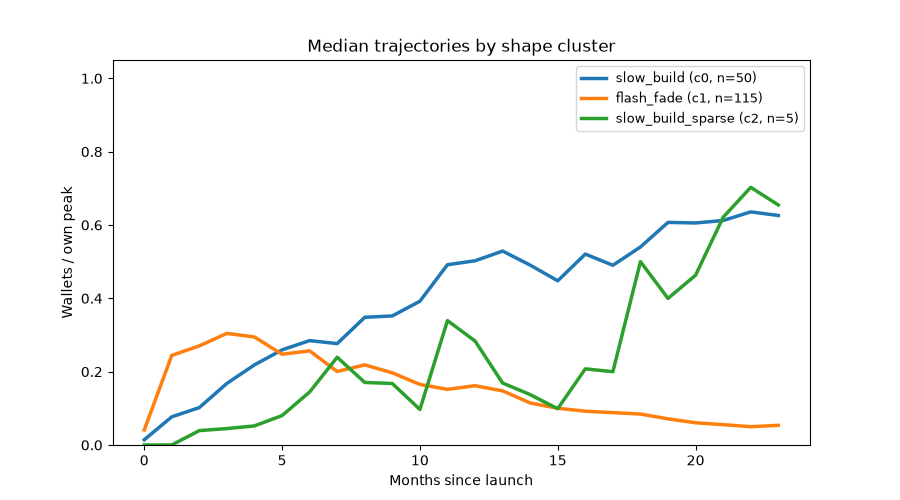

The calendar heatmap makes the same pattern visible in absolute time — waves of launches that light up and then dim:

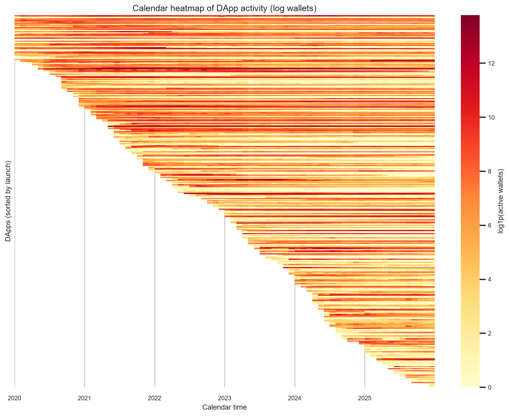

**Why this matters for modelling:** “Become popular” is not the same as “stay popular.” A DApp can spike into the top of the wallet distribution and still belong to `flash_fade`. Stage-2 prediction should decide whether the label is *peak scale*, *persistence*, or both.

Rule-based `lifecycle_label` (never_adopted 383 / gradual_decline 129 / flash 65 / sustained 25 / other 20) partially overlaps these clusters but is coarser — see `figures/03_cluster_vs_lifecycle.png`.

---

## 1. Data quality and modelling caveats

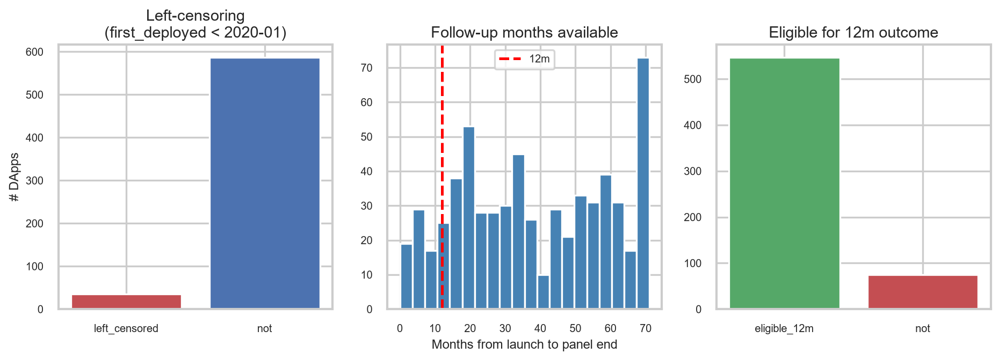

| Metric | Value |
|--------|------:|
| Lifecycle DApps | 622 |
| Left-censored (`first_deployed` < 2020-01) | 35 |
| Eligible for 12m outcome | 547 |
| Eligible for 24m outcome | 422 |
| Median follow-up (months) | 35 |
| Static DApps with no panel rows | 54 |

- **No internal panel gaps** inside each DApp’s observed span (good).
- **Heavy wallets** matter for tx/gas; prefer `*_ex_heavy` or explicit heavy-share features when studying organic users (`figures/01_heavy_wallet_share.png`).
- **Leakage risks** (do not use as predictors): `tvl`, full-history `lifecycle_label` / `decay_ratio` / peak metrics, unrestricted `early_prior_app_share`, post-launch `n_contracts`. Details in `tables/01_leakage_risks.csv` and `figures/01_leakage_table.png`.
- **Market regime:** 2021 bull market inflates absolute counts — use `share_of_ecosystem_*` as a regime-neutral alternative.

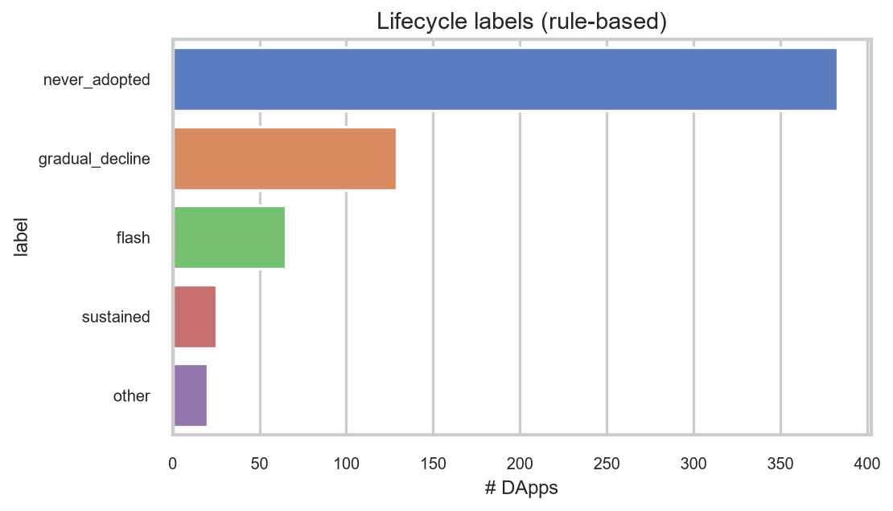

---

## 2. Which categories are growing or declining?

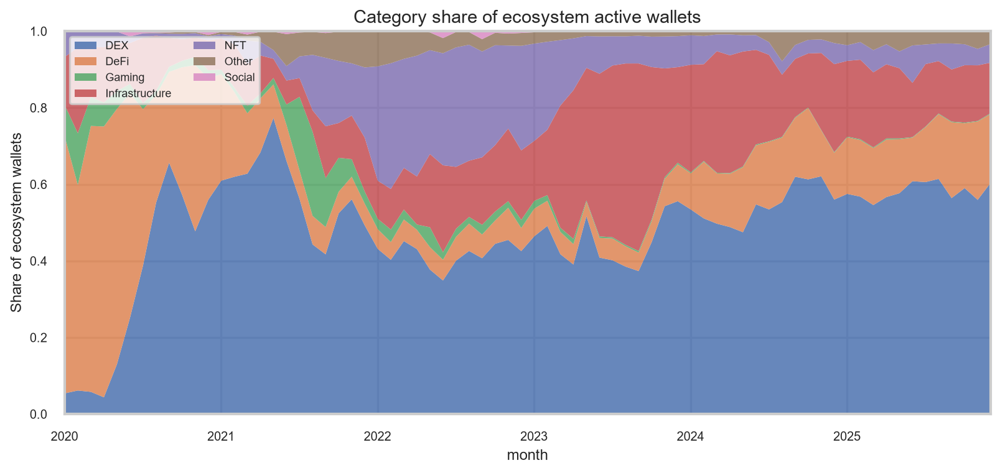

Latest 12-month wallet growth (Dec 2025 snapshot in `tables/02_latest_category_growth.csv`):

- Only **Social** shows positive 12m growth in this cut (tiny absolute base).
- **DeFi, DEX, Gaming, NFT, Infrastructure, Other** all show **negative** 12m growth — consistent with a cooler 2024–2025 market, not necessarily category death.
- Absolute activity remains dominated by **DEX** and **DeFi**.

Launches continue across years (`figures/02_launches_by_year.png`); category mix shifts toward DeFi/Infrastructure over time.

---

## 3. How concentrated is activity?

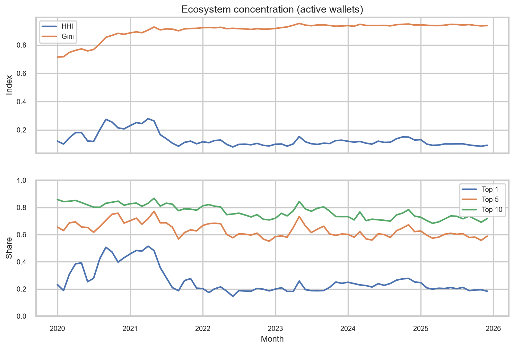

- Top-10 DApps still account for a very large share of ecosystem wallets; HHI/Gini stay high.
- **2025 Lorenz Gini ≈ 0.96** for annual wallet activity (`tables/02_lorenz_gini.csv`) — extremely unequal.

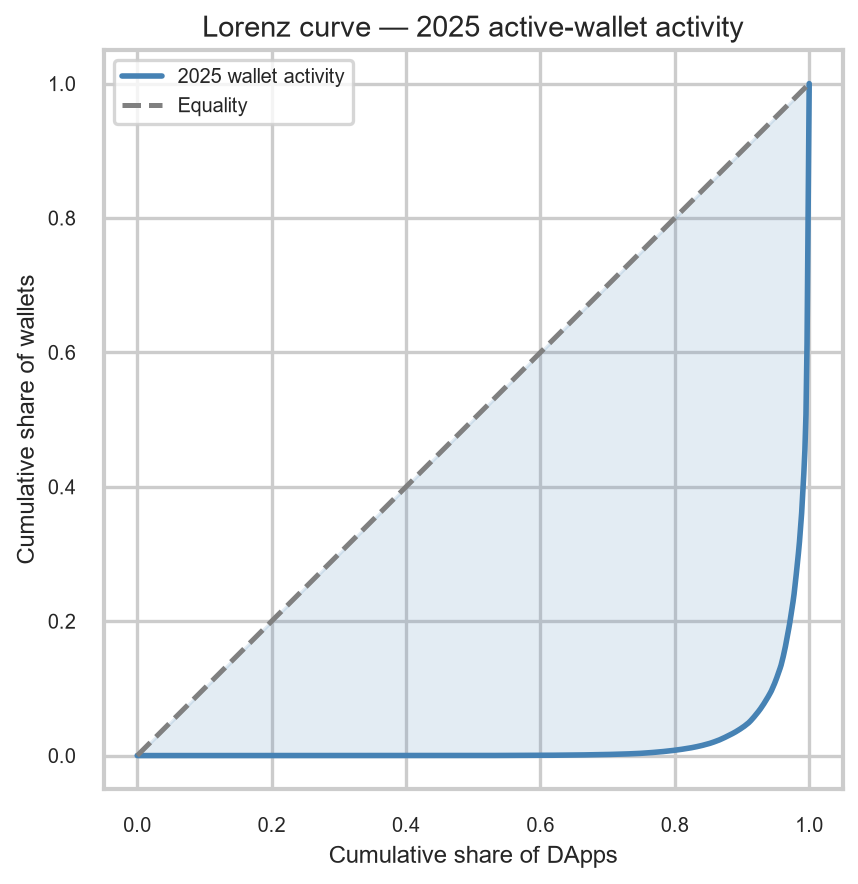

---

## 4. How quickly do successful DApps acquire users?

Among DApps with peak ≥ 1k wallets (`tables/04_median_time_to_threshold.csv`):

| Lifecycle | Median months to 1k | to 10k | to 50% of peak cum. |
|-----------|--------------------:|-------:|--------------------:|
| flash | 1 | 3 | 3 |
| gradual_decline | 2 | 7 | 13.5 |
| sustained | 2 | 9 | 28 |

Flash apps reach scale **fast** and also reach half of lifetime cumulative wallets early — another view of the headline pattern.

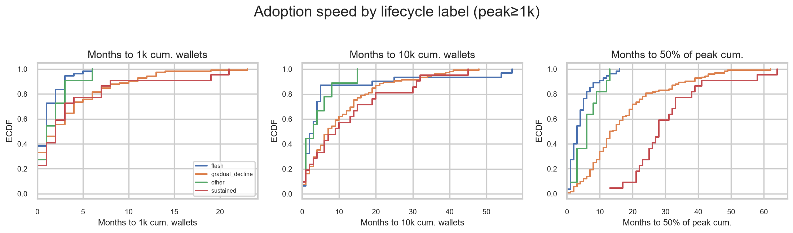

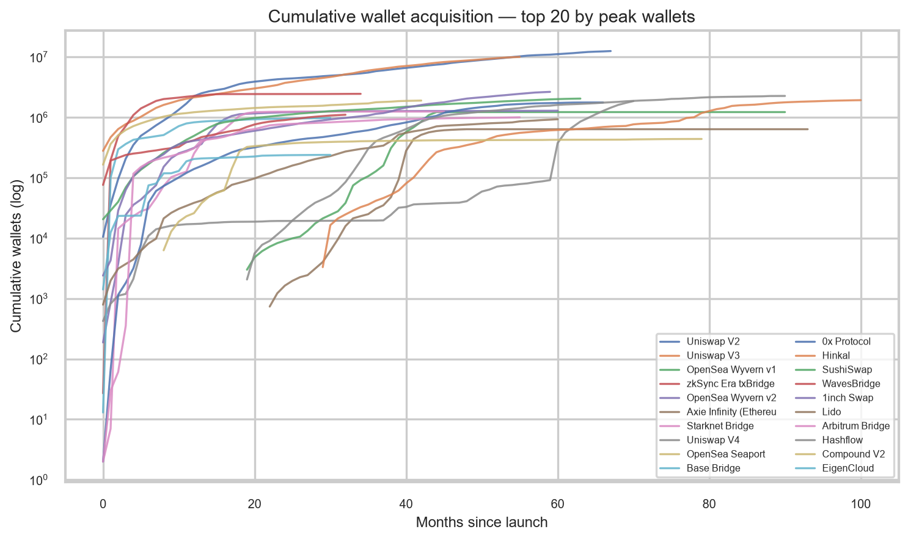

---

## 5. How persistent are users after first interaction?

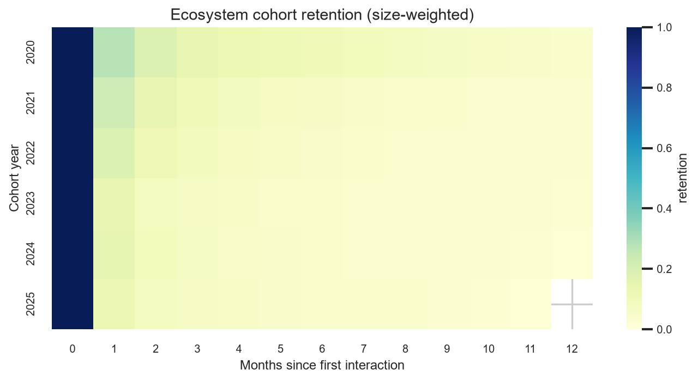

- Cohort retention drops sharply after month 0 across categories (see per-category heatmaps `04_cohort_heatmap_*.png`).
- Month-over-month retention at m1/m3/m6 differs by trajectory cluster (`figures/04_retention_by_cluster.png`).
- Cohort m1 retention is only **moderately autocorrelated** across successive cohorts for many DApps (`figures/04_retention_consistency.png`) — retention is not a perfectly stable DApp trait.

Kaplan–Meier “time from peak until activity < 20% of peak” (`figures/03_km_survival.png`) shows persistence differs by token status and category; token presence is associated with longer survival above the 20% threshold in this cut.

---

## 6. What happens before / around “wide adoption”?

Event study aligned on the month cumulative wallets first cross **10k** (167 DApps; −6 … +12 months):

 · static panels `05_event_*.png`

Compared with **flash** apps, **growers** (sustained + gradual_decline) tend to show:

- Higher / stickier MoM retention after the crossing
- Lower whale (top-10 wallet) concentration
- More persistent ecosystem wallet share after t=0

Flash apps often look “hot” at crossing (high new-wallet share) but fade in wallets and ecosystem share afterward. Checkpoint table: `tables/05_event_checkpoints.csv`.

---

## 7. Predictive feasibility (stage-2 groundwork)

### Setup (leakage-aware)

- **Features:** rebuilt from panel months `0 … k−1` only (k = 3 and 6): levels (wallets/tx/gas), growth slope, retention, new-wallet share, tx/wallet, gas/tx, whale share, heavy-wallet share, ecosystem share, category, token flag, launch year. **Excluded:** TVL, prior-app share, lifecycle/decay/peak labels.
- **Filters:** drop left-censored; require `eligible_12m` for labels.
- **Validation:** train launch_year ≤ 2022, test 2023–2024.

### Candidate targets (side by side)

| Target | Role | Time-split signal |
|--------|------|-------------------|
| **`y_peak_10k`** (peak wallets ≥ 10k) | Primary binary “became popular” | GBM AUC **0.90** (k=3) → **0.97** (k=6) |
| `y_peak_topq` (top-quartile peak) | Alternative binary | AUC ~0.91–0.96 |
| `y_log_wallets_m12` | Regression / ranking | R² **0.52–0.56** (k=3) → **0.67–0.70** (k=6) |
| Trajectory cluster / lifecycle | Multi-class persistence | Use as **secondary** label (flash vs slow_build), not alone |

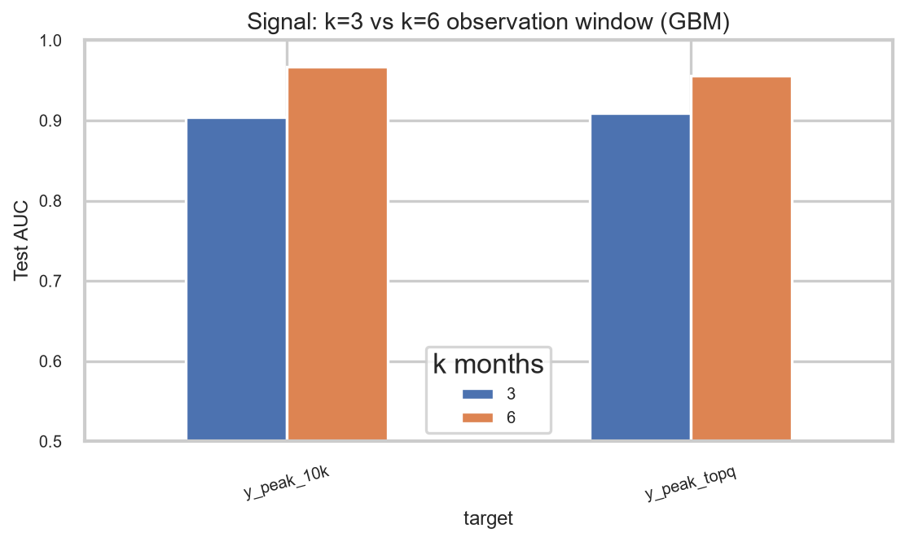

### What predicts early?

Univariate AUCs for `y_peak_10k` are dominated by **early activity levels** and **ecosystem share**; **high early whale share predicts the opposite** (lower chance of large peak):

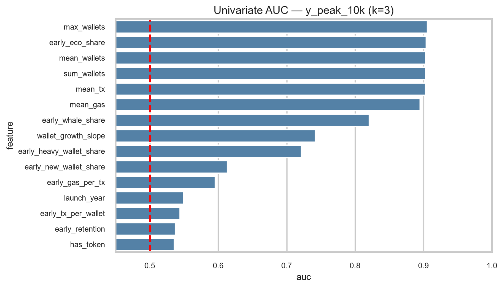

GBM permutation importance (k=3) elevates `mean_tx`, `wallet_growth_slope`, `early_eco_share`, `early_whale_share` — growth and composition matter beyond raw size (`figures/06_perm_importance_y_peak_10k_k3.png`).

### Important caveat (mechanical correlation)

For many flash DApps the **peak falls inside the first 3–6 months**, so early `max_wallets` is almost the peak. High AUC partly reflects that. For a fair “early → later popular” story:

1. Prefer labels measured **after** the observation window (e.g. wallets at month 12, or peak **after** month k).
2. Or predict **persistence** (still ≥ 20% of peak 12 months later / cluster = slow_build) using only months 0–2.
3. Report metrics with and without early level features to show incremental signal from growth/retention/whales.

### Recommendation for modelling phase

See `tables/06_modelling_recommendations.csv`:

1. **Primary label:** binary peak ≥ 10k **or** (better) log wallets at month 12, with peak-after-window variant as robustness.
2. **Secondary label:** flash_fade vs slow_build (persistence).
3. **Window:** start with **k=3** (earlier, more actionable); use **k=6** as an upper-bound on how much signal exists.
4. **Split:** time-based by launch year; optionally group by parent protocol.
5. **Never** feed TVL / full-history lifecycle features into the model.

---

## Answers to project stage-one questions (short)

| Question | Short answer |
|----------|--------------|
| Which categories grow/decline? | In 2025, most large categories show negative 12m wallet growth; DEX/DeFi still dominate levels. |
| How fast do successful DApps acquire users? | Flash: ~1–3 months to 1k/10k. Sustained: similar to 1k but much slower to half of lifetime cum. |
| How concentrated is activity? | Extremely — 2025 Gini ≈ 0.96; top-10 share remains high. |
| How persistent are users? | Cohort retention falls quickly; MoM retention and post-peak survival vary by cluster/token/category. |
| Growing vs short-then-decline? | ~68% of adopted trajectories are **flash_fade**; slow_build is the minority persistence pattern. |
| Metrics before wide adoption? | Around the 10k-cum crossing, growers keep retention and ecosystem share; flash apps spike on new users then fade. |
| Can early activity predict popularity? | **Yes, with strong time-split AUC**, but interpret carefully — early levels correlate mechanically with early peaks. Next models should target post-window outcomes and/or persistence. |

---

## How to reproduce

```powershell
cd "c:\Users\Anish\Downloads\dapp project"
.\.venv\Scripts\python -m pip install matplotlib seaborn plotly scikit-learn statsmodels tslearn lifelines
.\.venv\Scripts\python eda\run_all.py
```

Individual themes: `01_data_quality.py` … `06_predictive_eda.py`.
