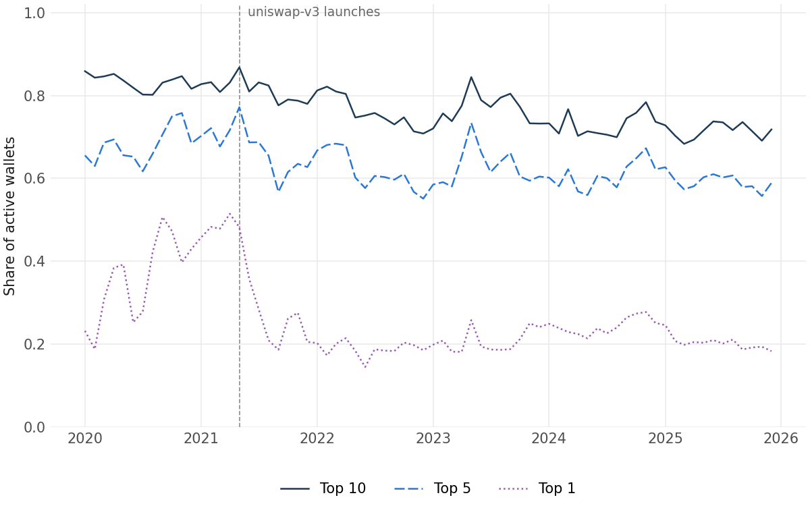
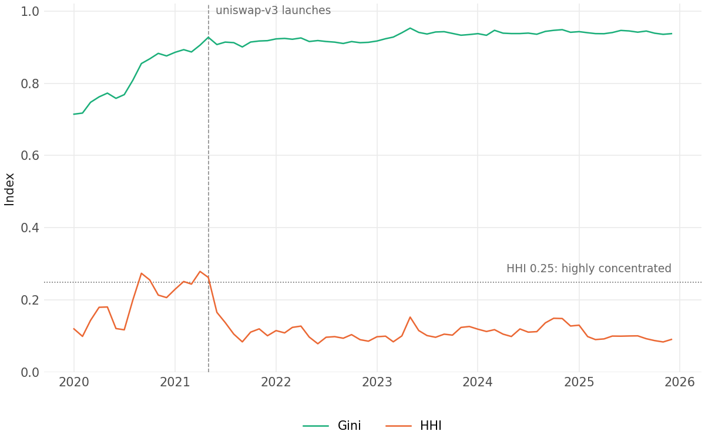
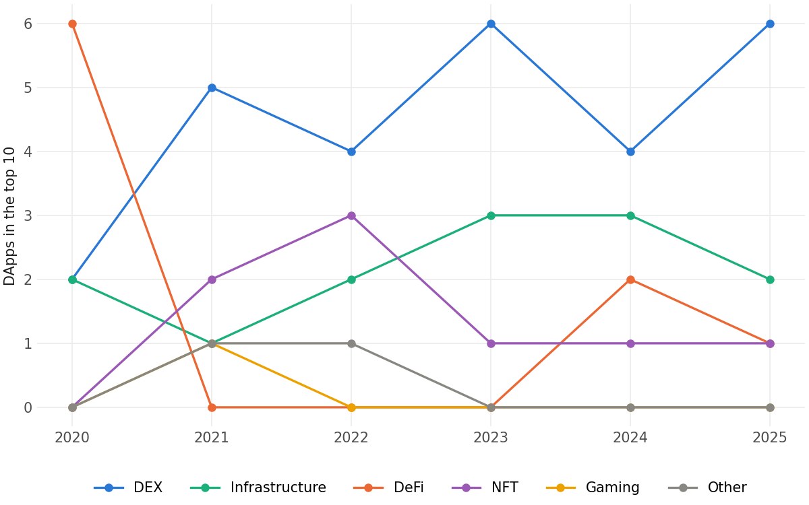
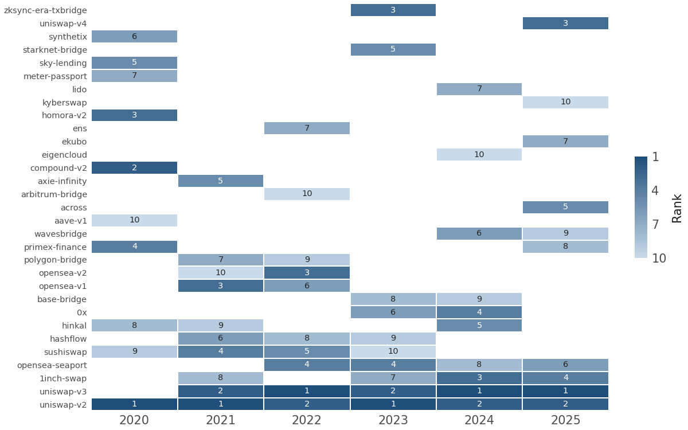
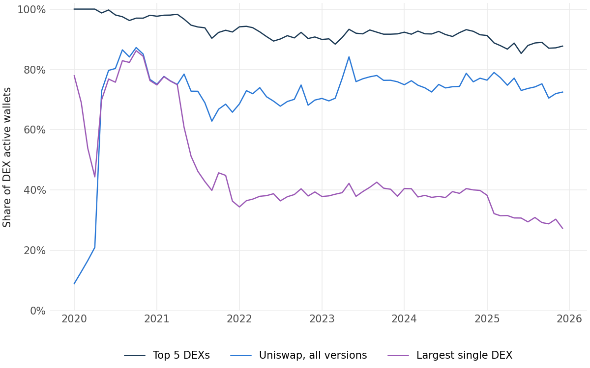
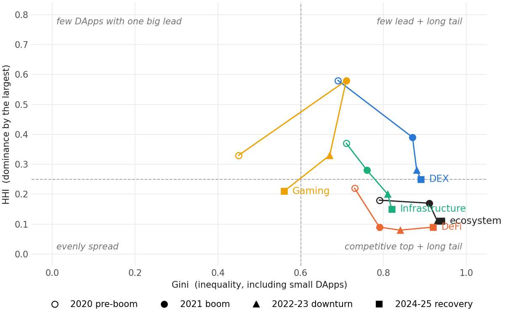
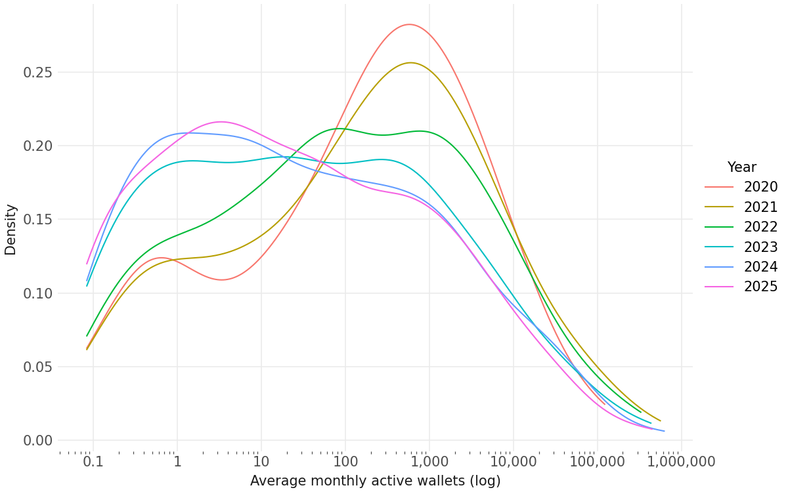
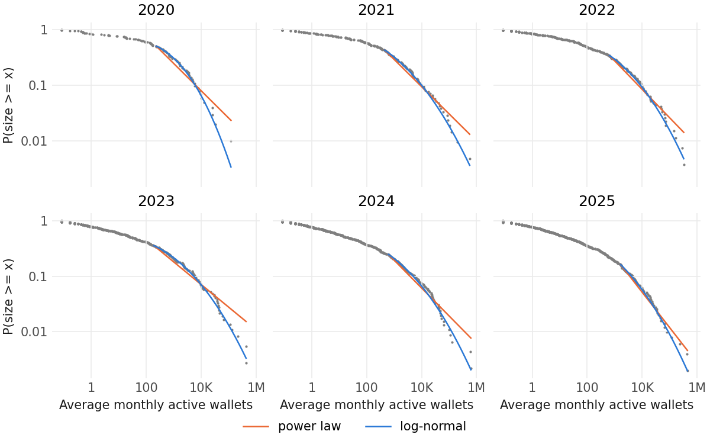

# How concentrated is DApp activity?

All results are descriptive. A wallet using two DApps in a month counts in both, and each Uniswap version counts as its own DApp.

---

## 1. A few apps hold most of the activity

*The top 10 always hold 70–80% of wallets.*

  
  

- **Top 10:** steady at 70–80%, so a few apps always hold most activity.
- **Top 1:** ~50% → ~20% in mid-2021, as Uniswap splits into v2 + v3 and others grow.
- **HHI** (0 = spread out, 1 = one app has it all): stays below 0.25 after mid-2021, so no single app dominates.
- **Gini** (0 = equal, 1 = a few own everything): keeps rising, so the gap comes from more tiny apps, not bigger leaders.

## 2. The leaders stay on top

*DEXs take over the top 10, and Uniswap stays first.*

  
  

- **DEX:** 2 of the top 10 in 2020, then 4–6 every year from 2021.
- **DeFi:** 6 in 2020, then almost gone from the top 10.
- **Uniswap:** first in all six years, so the top of the market barely changes.
- **Newcomers:** many enter for one year and drop out, so a top-10 spot is hard to keep.

## 3. DEX concentrated, DeFi competitive

*Uniswap leads exchanges; lending and yield stay spread out.*

  
  

- **Uniswap (all versions):** ~75% of DEX wallets every year since 2021.
- **Largest single DEX:** falls to ~30%, but only because Uniswap splits into versions.
- **Up = one app dominates, right = long tail of tiny apps:** after 2021 most categories move down and right, so leaders lose share while small apps pile up.
- **DEX** stays near the 0.25 line, **DeFi** stays low (no app dominates), and **Gaming** spiked with Axie Infinity in 2021.

## 4. Most apps are tiny

*Almost half average under 10 wallets a month.*

  
  

- **2020–21:** most DApps are mid-sized, a few hundred wallets.
- **2024–25:** the hump moves left; almost half now have under 10 wallets. We keep them: they are our failure cases.
- **Sizes follow a log-normal curve, not a power law** (power law rejected every year, p ≤ 0.1).
- **Leaders stay on top, but being big does not make them grow faster:** DApps grow by percentages, so newcomers can still catch up.

---

## Next steps

- **Most DApps are tiny:** keep them, since they are our failure cases.
- **A few DApps hold most activity:** check results with and without the leaders.
- **Categories behave differently:** look inside each category next.
- **Sizes are log-normal:** model log wallets and growth rates in Q4.

## Limitations

- **Protocol vs app:** counted as one app, Uniswap holds about half of all wallets in 2024–25, so concentration is higher than shown.
- **Listed DApps only:** only DeFiLlama-listed DApps are included, so the data lean towards ones that did well.
- **Small tails:** the power-law tests use 52–131 DApps a year, so they have limited power.
