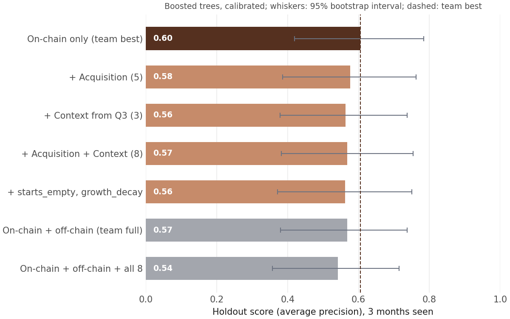

# Candidate features for the team model

The team features all use monthly active wallets. Q4 shows that successful DApps differ in how they acquire new users, and Q3 shows that markets differ in how concentrated they are. These candidate features bring both into the model.

**Code:** `script/features.py`  
**Output:** `data/dapp_acquisition_features.csv`, one row per DApp and k (1, 3, 6)  
**Join:** to `model/features.py` on `slug` and `k`

## Rules

- **No look-ahead:** only months 0..k-1, so nothing after the window leaks in.
- **Same sample as the model:** the deploy clock and the 512 DApps of `model/labels.py`.

## Features: Acquisition (new group, 5)

How a DApp acquires new users, from cumulative wallets (Q4).

| Feature | From the first k months | Finding behind it |
|---|---|---|
| `log_cum_wallets_k` | Cumulative wallets (log) | Successful DApps start bigger |
| `cum_growth_last` | New users in the last month ÷ users so far | Successful DApps keep growing |
| `growth_decay` | Last-month growth minus first-month growth (log) | Is growth slowing |
| `months_to_first_user_k` | Months from deploy to first user | Clean vs late start |
| `starts_empty` | Under 10 wallets in the first month with users | Test wallets start the clock |

## Features: Context (+3 to the existing group)

The market a DApp launches into, in its launch month (Q3).

| Feature | In the launch month | Finding behind it |
|---|---|---|
| `category_hhi_at_launch` | Category HHI | Concentrated markets |
| `category_top1_share_at_launch` | Category leader's share | Markets with one leader |
| `category_n_dapps_at_launch` | Active DApps in the category | Crowded markets |

## Test in the team model

Same split and models as `model/train_eval.py` (train on launches up to 2022, score the 2023–24 holdout, k = 3), on the team's on-chain and off-chain feature groups. Run with `python script/test_features.py` (needs the team's off-chain model code); full results in `results/tables/feature_test_k3.csv`.

  

- **No gain:** none of the additions beat the calibrated on-chain model (0.60). The closest: in uncalibrated boosted trees, `starts_empty` and `growth_decay` lift 0.57 to 0.60, but only to the same level.
- **Within noise:** the 95% intervals run from about 0.35 to 0.8, since the holdout has only about 30 successful DApps.
- **Same as off-chain:** on their own, cumulative wallets separate the groups well, but they overlap with the team's size features; size already carries most of the signal, so keep these as an optional block, not the default model.
