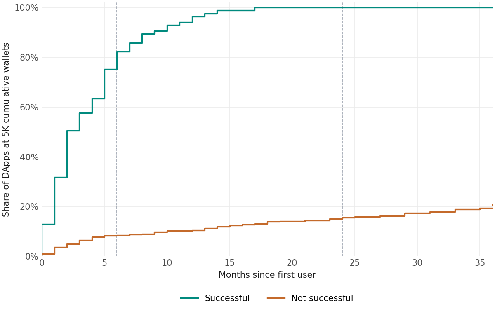
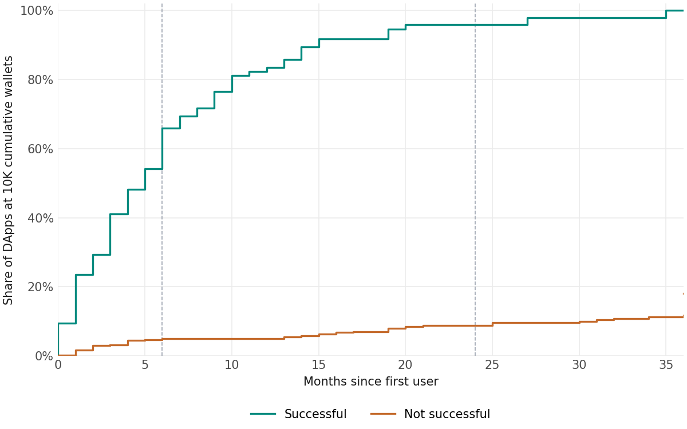
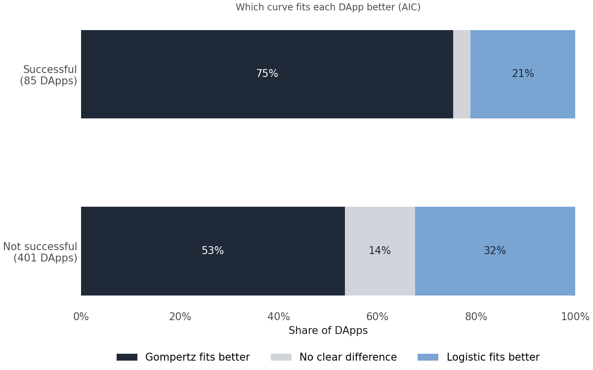
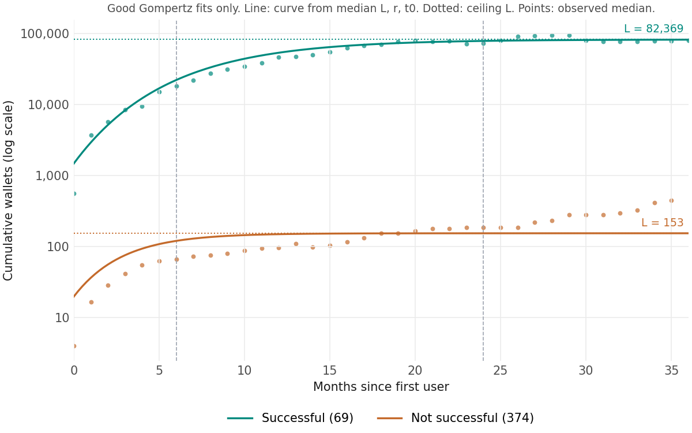
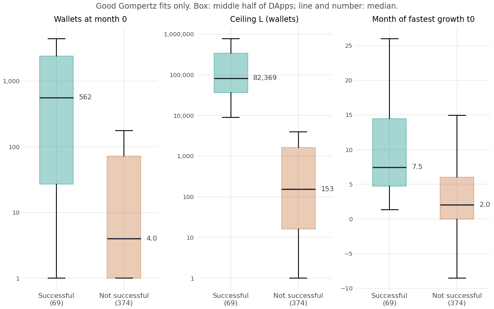
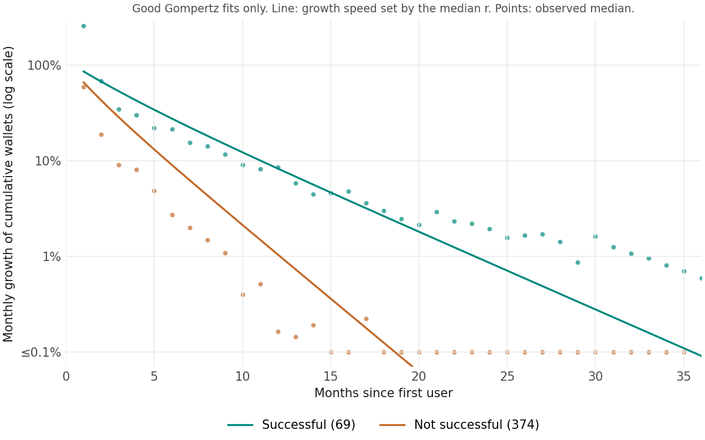
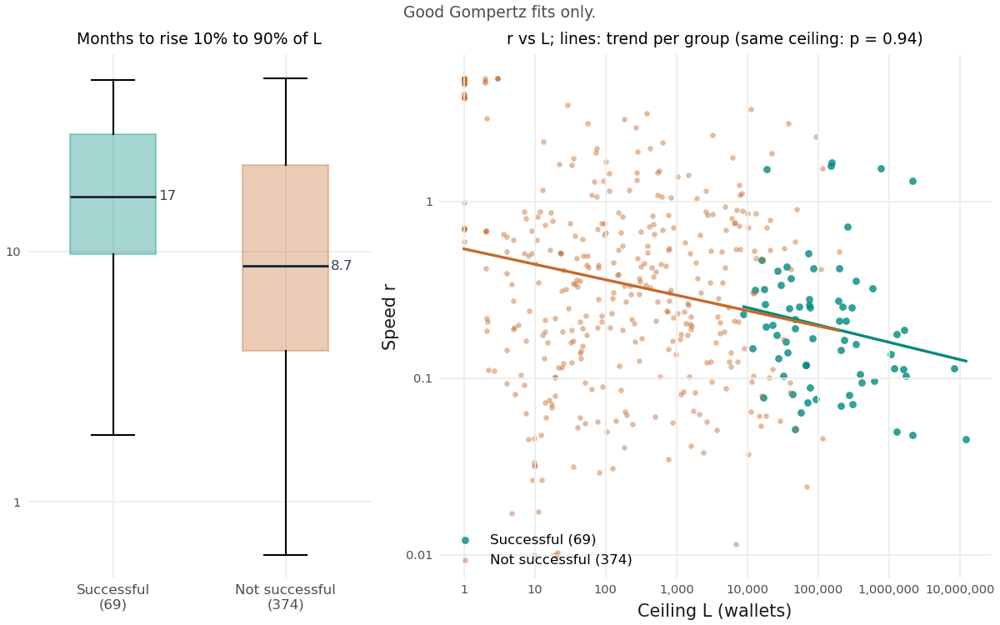

# How quickly do successful DApps acquire users?

486 DApps counted from their first user: 85 successful (the team's rule at k = 3) and 401 not. Sections 3–4 use good Gompertz fits only (69 vs 374). All results are descriptive.

---

## 1. Successful DApps reach 5K and 10K far earlier

  
  

- **The gap opens early:** by month 6, 82% vs 9% reach 5K and 66% vs 5% reach 10K.
- **And never closes:** by month 24, 100% vs 16% reach 5K and 96% vs 9% reach 10K.

## 2. Gompertz fits better than logistic

  

- **Gompertz fits better:** for 75% of successful DApps and 53% of the rest, so it is our main curve.
- **Same answer either way:** logistic also finds a far higher ceiling and no faster growth.

## 3. Bigger start, higher ceiling

  
  

- **Different start:** about 560 vs 4 wallets at month 0, so early size already signals success.
- **Higher ceiling:** L is 82K vs 153 wallets.
- **Later peak:** growth is fastest at month 7.5 vs 2.

## 4. Not faster, but growing for longer

  
  

- **They keep growing:** 8.6% a month at month 12 vs 0.2%; the others stop by about month 10.
- **Longer rise:** 17 vs 9 months to go from 10% to 90% of the ceiling.
- **Same speed at the same ceiling:** both groups sit on one r–L line (p = 0.94); successful DApps just climb higher.

---

## Next steps

- **Early size is the signal:** it backs the team model, where last-month wallets alone predict almost as well as all 27 features.
- **Look beyond size:** off-chain data may carry what size does not.
- **Add how DApps acquire users:** eight candidate model features, tested in the team model with no clear gain; see [FEATURES.md](FEATURES.md).
- **Start the clock at real use:** e.g. the first month with 10 wallets, so test wallets do not start it.

## Limitations

- **Two groups, not a cause:** success is defined from months 10–12.
- **Poor fits:** 16 successful DApps fit poorly; they start with about 2 test wallets, then jump.
- **Flat DApps:** about 50 DApps jump once and stay flat, so their speed is not well defined.
- **Clock:** results use the first-user clock, not the deploy month.
