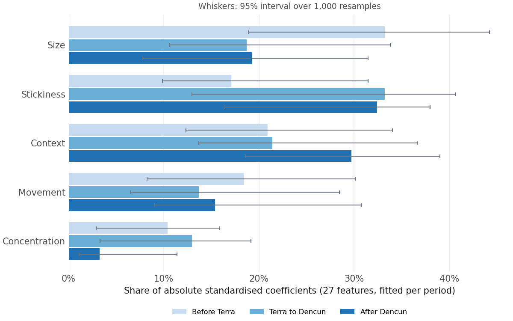
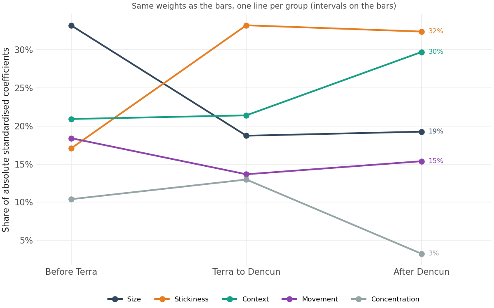
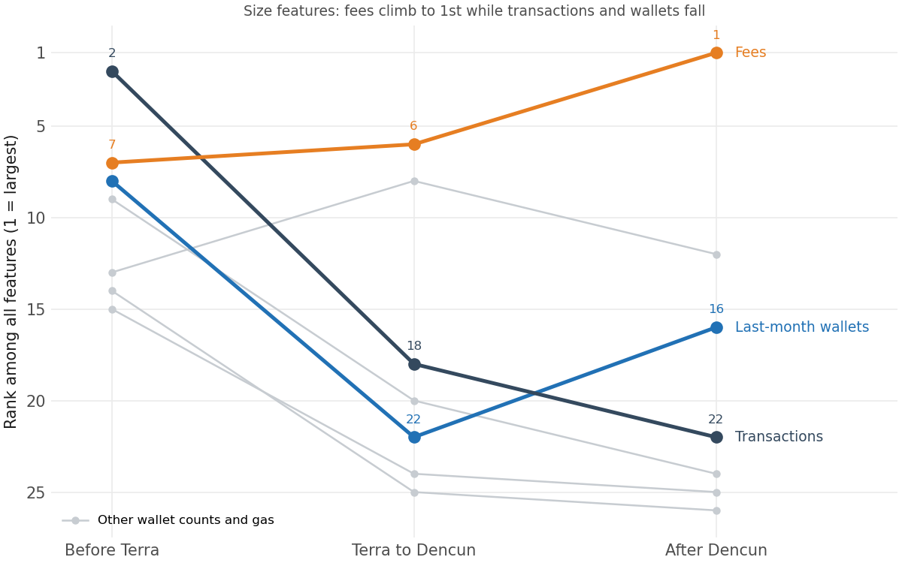

# What drives success in each period

Detail for section 4 of [REPORT.md](REPORT.md).

**In short:** same definition of success, different rules behind it; after Terra, stickiness replaces size.

## 1. Which group carries the weight

**Size falls from 1st to 3rd of five groups after Terra, and stickiness rises from 4th to 1st** (weight = each group's share of all absolute coefficients; features standardised, so coefficients compare directly).

  
  

- **After Terra:** size falls from 33% to 19%, and stickiness rises from 17% to 33%.
- **After Dencun:** context rises from 21% to 30%, about even with stickiness (32%), and concentration almost vanishes (13% to 3%).

## 2. What happens to size

**Transactions drop from 2nd to 22nd, while fees stay in the top 8 and become 1st after Dencun** (rank among all features, 1 = largest).

  

- **Wallet counts fall too:** from 8th–15th before Terra to 16th–26th after Dencun.
- **Fees also flip sign:** from −0.61 before Terra to +1.32 after Dencun.
- **Caution:** the four wallet counts are nearly the same, so the model splits their weight and each looks small; fees also rise with size, so part of fees' weight may really be size.

## 3. The largest coefficients after Dencun

**Fees, the category's share and transactions per wallet carry 35% of all weight after Dencun** (ranked by absolute coefficient, either sign; share of all 26 features, category left out).

| Rank | Feature | Group | Coefficient | Share | Cumulative |
|---|---|---|---|---|---|
| 1 | `log_mean_fees` | Size | +1.32 | 12.6% | 12.6% |
| 2 | `early_cat_share` | Context | −1.24 | 11.8% | 24.4% |
| 3 | `early_tx_per_wallet` | Stickiness | +1.15 | 10.9% | 35.3% |
| 4 | `launch_cat_growth_3m` | Context | −0.71 | 6.7% | 42.0% |
| 5 | `wallet_growth_slope` | Movement | +0.65 | 6.2% | 48.2% |
| 6 | `early_new_wallet_share` | Stickiness | +0.62 | 5.9% | 54.1% |
| 7 | `early_returning_share` | Stickiness | −0.55 | 5.2% | 59.3% |
| 8 | `months_since_inwindow_peak` | Movement | +0.47 | 4.5% | 63.8% |

**How the weight is spread**

- **The top 8 carry 64%:** the other 18 features share about a third.
- **Few clear signals:** of 26 features after Dencun, only 2 have a clear direction and 6 more a hint.

**What the users show**

- **New users keep arriving:** the share of new wallets is positive in every period (94–98% of resamples).
- **Returning wallets go with failure after Terra** (−0.91, then −0.55): few new users and only old ones left.
- **After Dencun, use per wallet counts:** transactions per wallet jump from about 0 to +1.15.

## 4. Summary

Before Terra, success goes with many early wallets and transactions. After Terra, size counts for less and what matters is new users that keep arriving. After Dencun, new users still matter, and heavier use per wallet and higher fees join them. These changes coincide with the events; they do not show that the events caused them.
