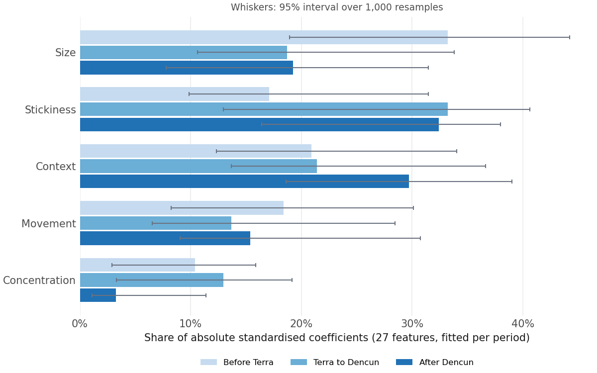
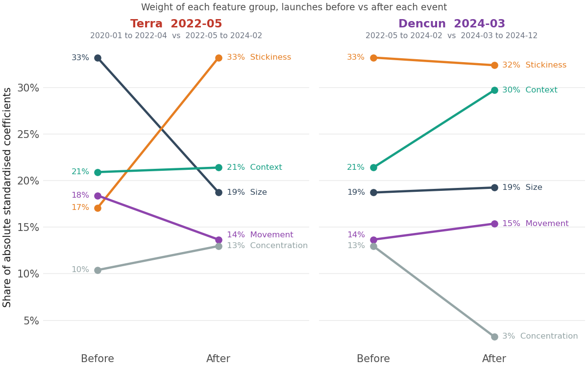
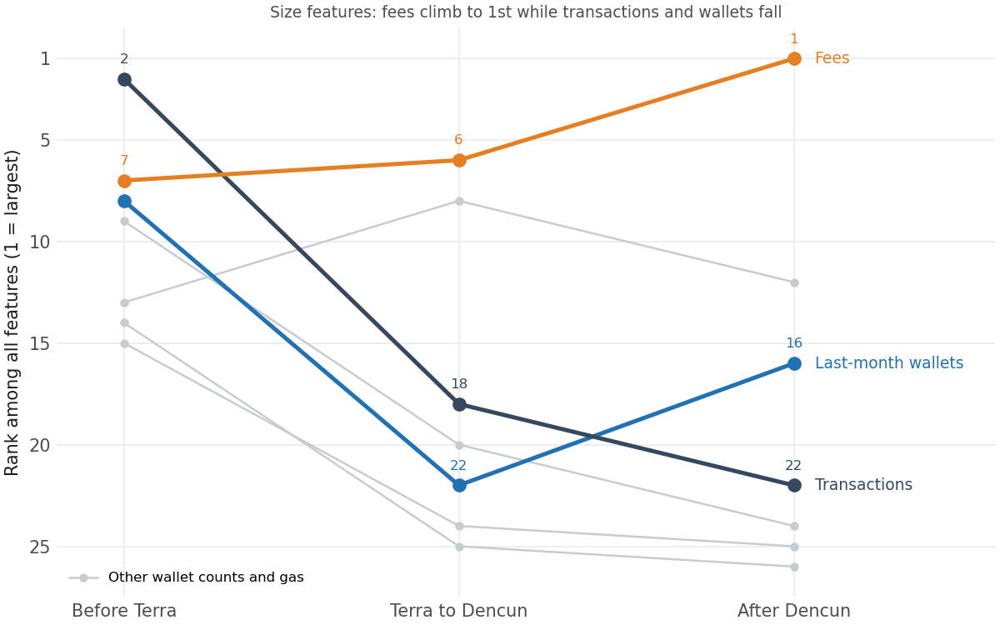
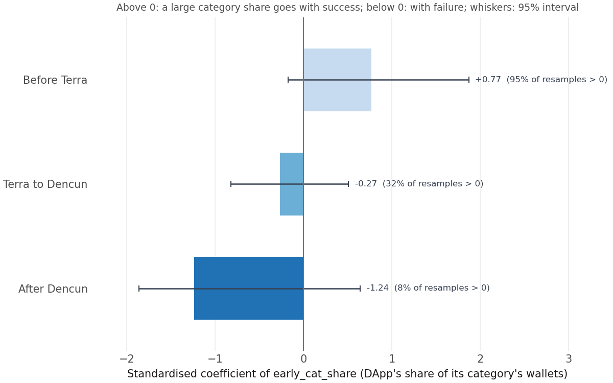

# What drives success in each period

**In short:** at Terra, stickiness replaces size as the largest group; at Dencun, context gains and fees become the largest single feature.

Three launch periods, split at Terra (2022-05) and Dencun (2024-03), each fitted on its own. Weight = a group's share of all absolute standardised coefficients.

## 1. Which group carries the weight

**At Terra, size falls from 1st to 3rd of five groups and stickiness rises from 4th to 1st; at Dencun, both stay put and context gains.**

  
  

- **Left:** size is the largest group before Terra, stickiness after it.
  - **How to read:** each group's weight in each period, with 95% intervals over 1,000 resamples.
- **Right:** Terra moves weight from size to stickiness; Dencun moves it to context.
  - **Terra:** size 33% → 19%, stickiness 17% → 33%.
  - **Dencun:** size and stickiness barely move (19%, 33% → 32%); context 21% → 30%, concentration 13% → 3%.

## 2. What happens to size

**Transactions drop from 2nd to 18th at Terra and to 22nd at Dencun, while fees become 1st at Dencun** (rank among all features, 1 = largest).

  

- **Wallet counts:** 8th–15th, then 20th–25th after Terra and 16th–26th after Dencun.
- **Fees:** −0.61, then +0.60 after Terra and +1.32 after Dencun.
- **Caution:** the four wallet counts are nearly the same, so the model splits their weight; fees rise with size, so part of their weight may be size.

## 3. The largest coefficients after Dencun

**Fees, the category's share and transactions per wallet carry 35% of all weight** (ranked by absolute coefficient; 26 features, category left out).

| Rank | Feature | Group | Coefficient | Share | Cumulative |
|---|---|---|---|---|---|
| 1 | `log_mean_fees` | Size | +1.32 | 12.6% | 12.6% |
| 2 | `early_cat_share` | Context | −1.24 | 11.8% | 24.4% |
| 3 | `early_tx_per_wallet` | Stickiness | +1.15 | 10.9% | 35.3% |
| 4 | `launch_cat_growth_3m` | Context | −0.71 | 6.7% | 42.0% |
| 5 | `wallet_growth_slope` | Movement | +0.65 | 6.2% | 48.2% |
| 6 | `early_new_wallet_share` | Stickiness | +0.62 | 5.9% | 54.1% |
| 7 | `early_returning_share` | Stickiness | −0.55 | 5.2% | 59.3% |
| 8 | `months_since_inwindow_peak` | Movement | +0.47 | 4.5% | 63.8% |

- **The top 8 carry 64%;** the other 18 features share about a third.
- **Few clear signals:** only 2 features have a clear direction and 6 more a hint.

## 4. Category share across the periods

**A large category share goes with success before Terra and with failure after it.**

  

- **Coefficient:** +0.77 before Terra (95% of resamples above 0), −0.27 from Terra to Dencun (32%), −1.24 after Dencun (8%).

## 5. What the users show

**New users go with success in every period; returning users go with failure from Terra on.**

- **New-wallet share:** positive in every period (94–98% of resamples).
- **Returning-wallet share:** −0.91 from Terra to Dencun and −0.55 after Dencun.
- **Transactions per wallet:** about 0 until Dencun, then +1.15.

## 6. Summary

Before Terra, success goes with many early wallets and transactions. At Terra, size counts for less and new users that keep arriving matter more. At Dencun, size stays low, and heavier use per wallet and higher fees join new users. These changes coincide with the events; they do not show that the events caused them.
