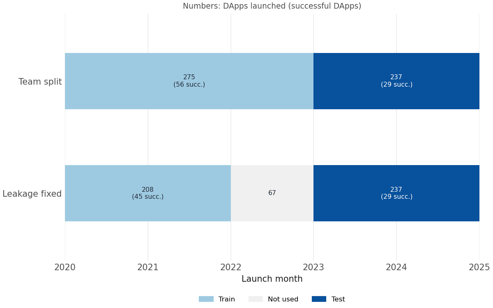
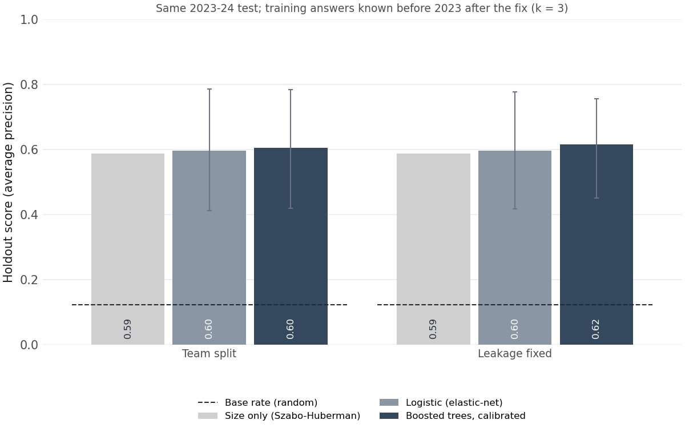
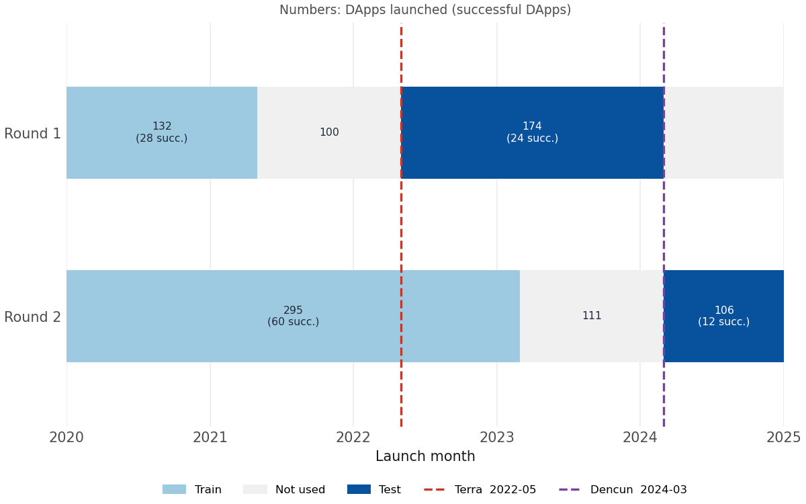
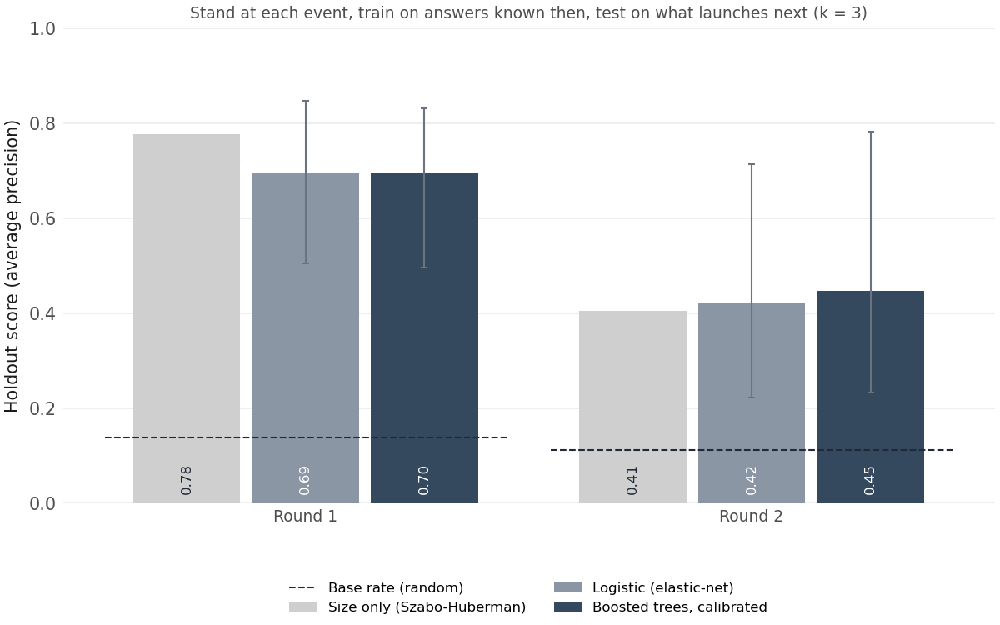
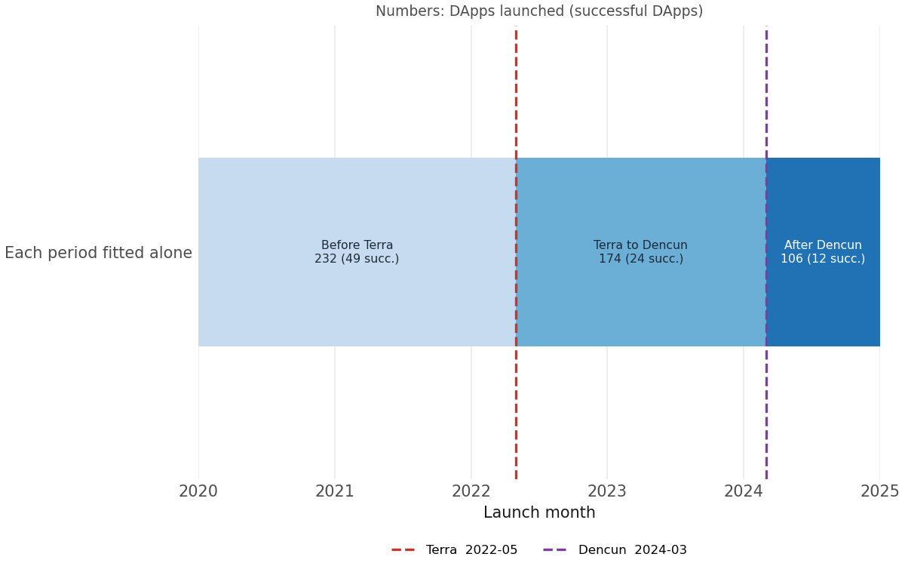
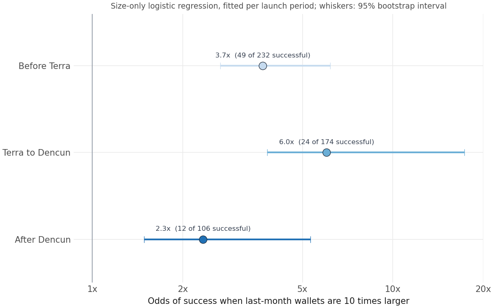

# Does the team model hold up over time?

**In short:** the team's score holds up, but it comes almost entirely from early size, and how well size predicts changes with the market.

---

## 1. Fix the leakage first

**The team's split lets some training answers come from the test years; removing them barely changes the score.**

  
  

- **Left:** the team's split trains on 2022 launches whose answers come from the test years; the fix leaves them out.
  - **Leakage:** answers come 12 months after launch, so the 67 DApps launched in 2022 train on answers from 2023, inside the test.
  - **Fix:** train only on launches up to 2021-12; the test is unchanged.
- **Right:** removing them barely changes the score.
  - **How to read:** holdout average precision (AP) for each model on the same 2023–24 test; random ranking scores the success rate, about 12%.
  - **AP:** 0.605 before the fix and 0.615 after, so the team's 0.60 is not inflated.

## 2. Split by two market events, and compare with size alone

**At both Terra (2022-05) and Dencun (2024-03), the full model never clearly beats size alone.**

  
  

- **Left:** each round trains on DApps whose answers were known at the event and tests on DApps launched after it.
  - **Round 1, at Terra:** train on 2020-01 to 2021-04, leave out 2021-05 to 2022-04, test on 2022-05 to 2024-02.
  - **Round 2, at Dencun:** train on 2020-01 to 2023-02, leave out 2023-03 to 2024-02, test on 2024-03 to 2024-12.
- **Right:** in neither round does the full model clearly beat size alone.
  - **How to read:** AP for size alone and the learned models; the dashed line is the success rate.
  - **Round 1:** 0.70 against a 14% success rate; size alone (Szabo–Huberman) does better, 0.78.
  - **Round 2:** 0.45 against 11%, with only 12 successful DApps; size alone 0.41.

## 3. Size effect in each period, fitted separately

**Size matters most from Terra to Dencun and least after Dencun.**

  
  

- **Left:** Terra and Dencun split the launches into three periods (232, 174 and 106 DApps), each fitted on its own.
- **Right:** 10 times more early wallets raise the odds of success 3.7 times before Terra, 6.0 times from Terra to Dencun, and 2.3 times after Dencun.
  - **How to read:** a size-only logistic regression per period, with 95% intervals.
  - **Not a steady trend:** there are only three periods and the intervals overlap, so this may not be a real change.

---

## Limitations

- **Small tests:** 12–24 successful DApps per round, so intervals are wide; round 2 should be rechecked as more data comes in.
