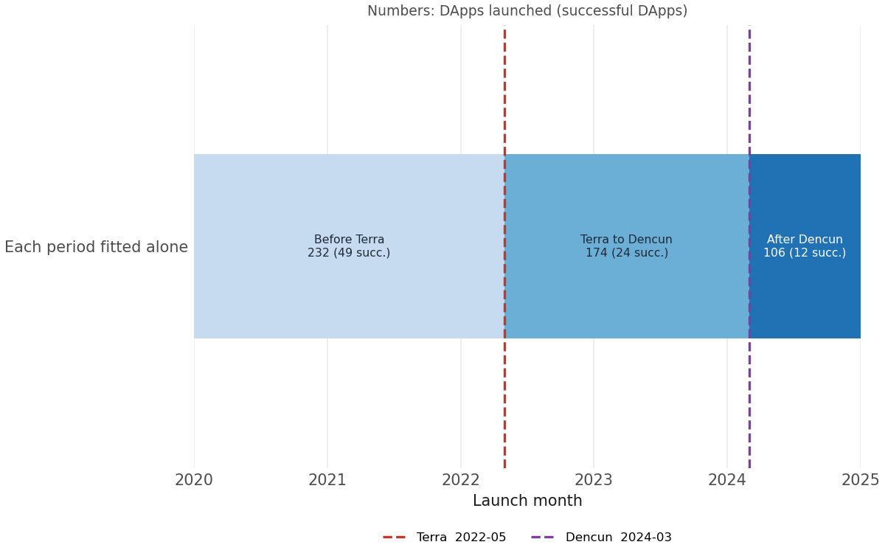
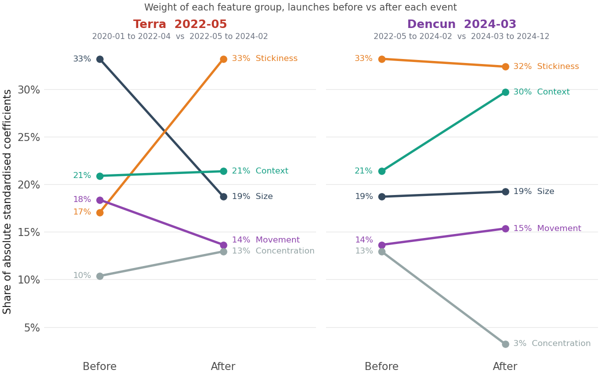
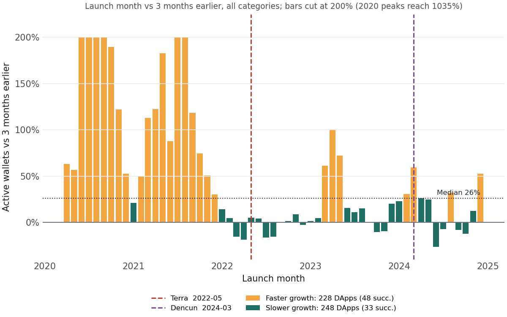
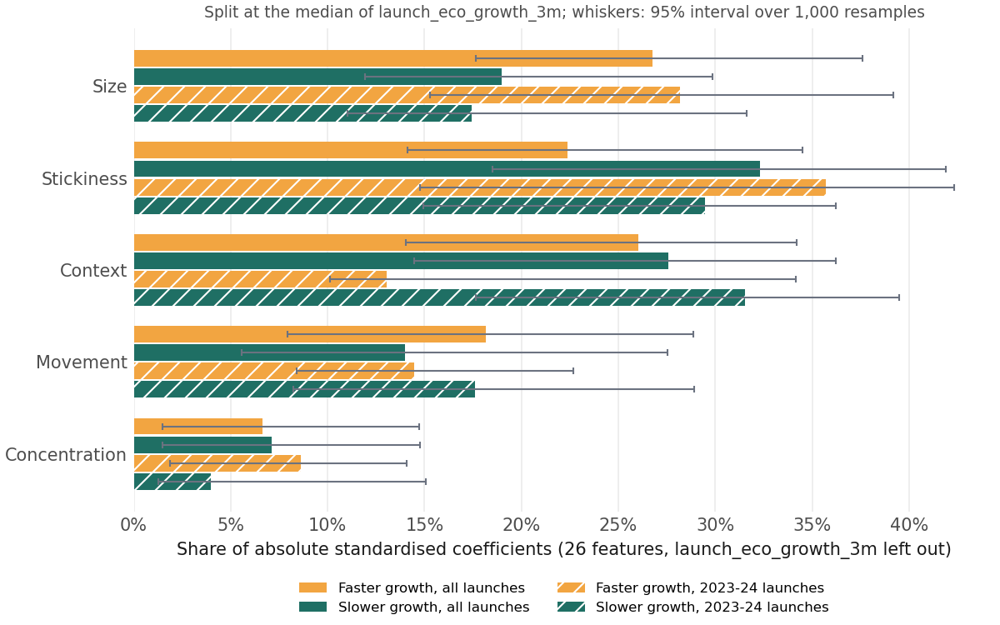
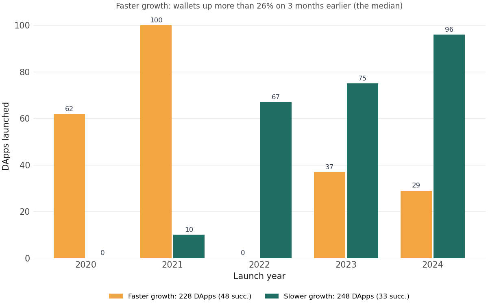
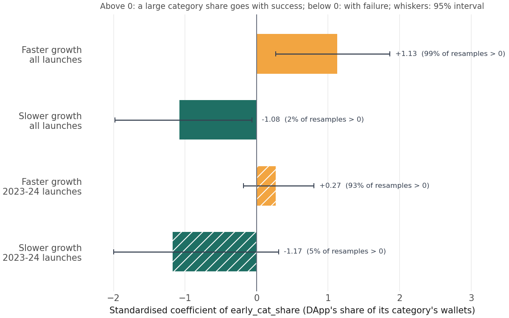

# Presentation order

**In short:** early size predicts success, but how much depends on the market: when the market grows slowly, size matters less, and a large share of the category is linked to failure instead of success.

Three slides, two figures each; the bullets are what to say, in order. Details: [REPORT.md](REPORT.md) (findings), [FEATURE_WEIGHTS.md](FEATURE_WEIGHTS.md) (per-period weights), [MODEL_CHECKS.md](MODEL_CHECKS.md) (training and testing).

---

## Slide 1. At Terra, early size counts for less; at Dencun, it stays low

  
  

- **Start from size:** size alone predicts success about as well as all 27 features. Does it always matter this much, or do other features take over at times?
- **Left:** Terra and Dencun cut the launches into three periods (232, 174 and 106 DApps), each fitted on its own.
- **Right:** at Terra, size drops; at Dencun, it stays low.
  - **Terra:** size 33% → 19% of the weight; stickiness rises.
  - **Dencun:** size stays at 19%; context rises.
  - **Category share:** +0.77 → −0.27 at Terra, −1.24 at Dencun.

## Slide 2. Slower market growth shows the same shift

  
  

- **New question:** Terra is one point in time. Is the shift the event, or the market around it?
- **Left:** group DApps by market growth at launch, not by date: active wallets in the launch month vs 3 months earlier (`launch_eco_growth_3m`), split at the median, +26%.
- **Right (solid bars):** with slower growth, size falls from 27% to 19%, as at Terra; category share flips, +1.13 vs −1.08.

## Slide 3. Within the same years, size and category share still hold

  
  

- **Left:** the two halves fall in different years, so keep only 2023–24, the only years with both (66 and 171 DApps).
- **Right:** within 2023–24, category share still flips (+0.27 vs −1.17).
  - **Also holds:** size counts for less with slower growth (28% vs 17%, hatched bars on slide 2).
  - **Does not hold:** the rise in stickiness (36% vs 29%), so it looks like a change over time.

*Small samples (9 successful DApps in the 2023–24 faster half); associations, not causes; Ethereum L1 only.*

---

**Next:** rerun the model checks with the 49 features on `sentiment-analyzer-pipeline` (27 on-chain, 6 off-chain, 16 news).
