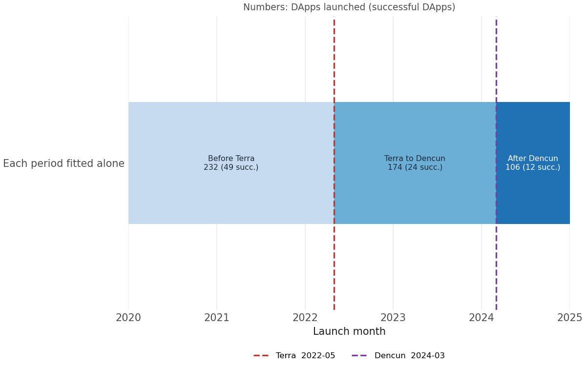
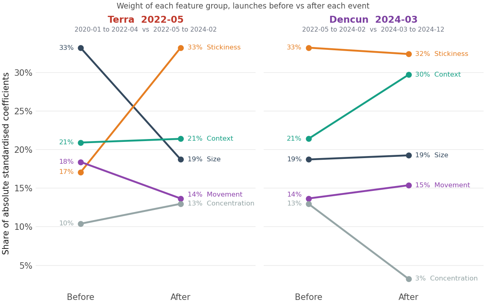
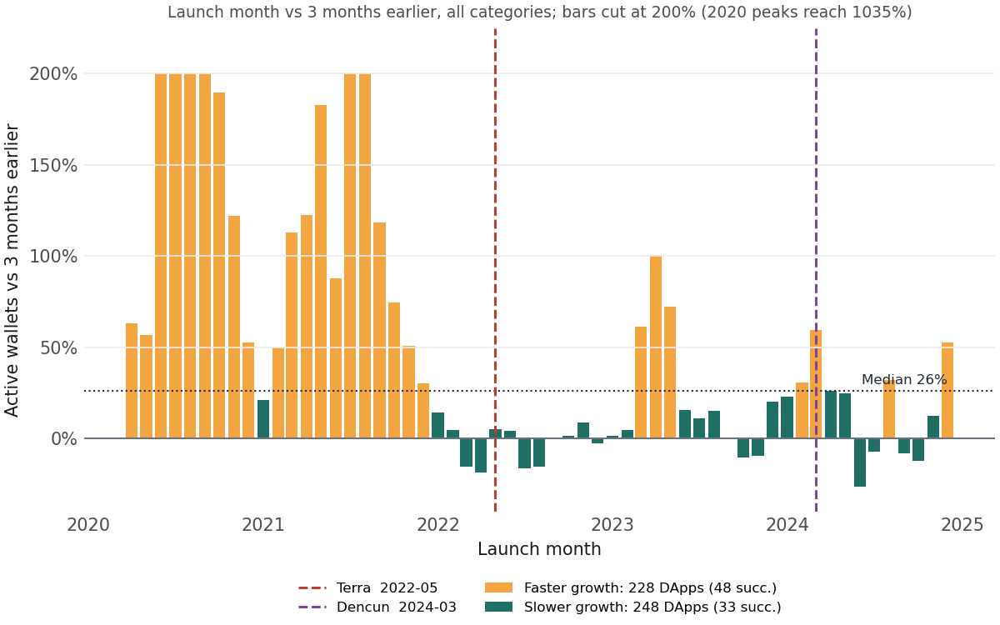
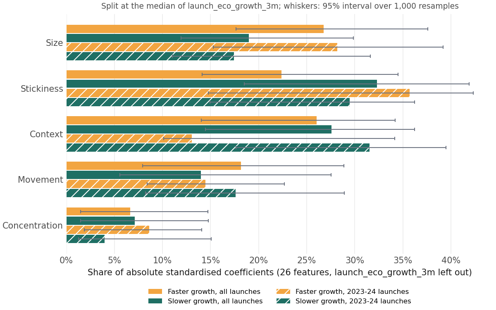
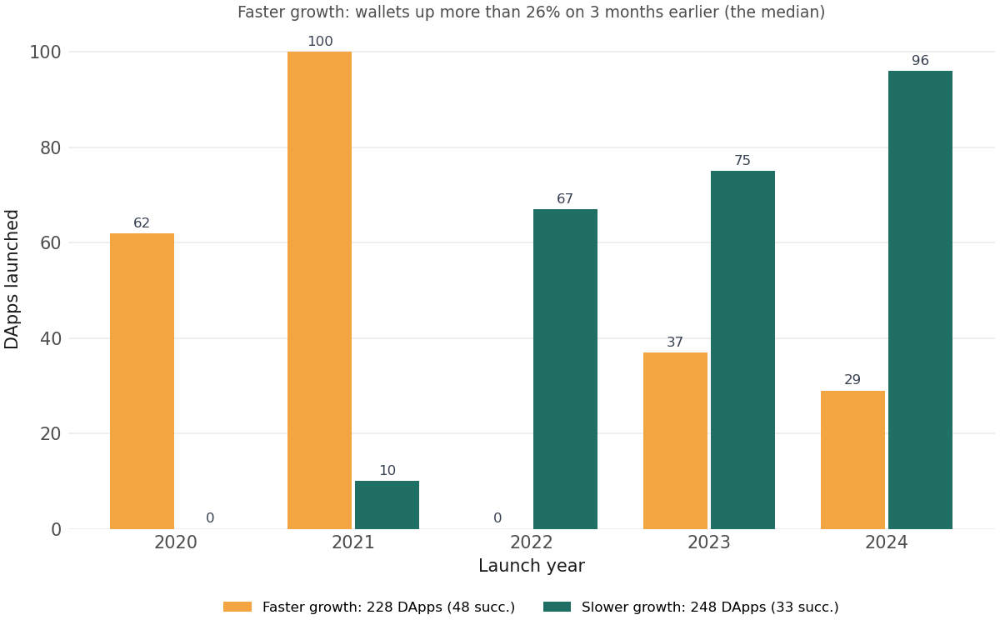
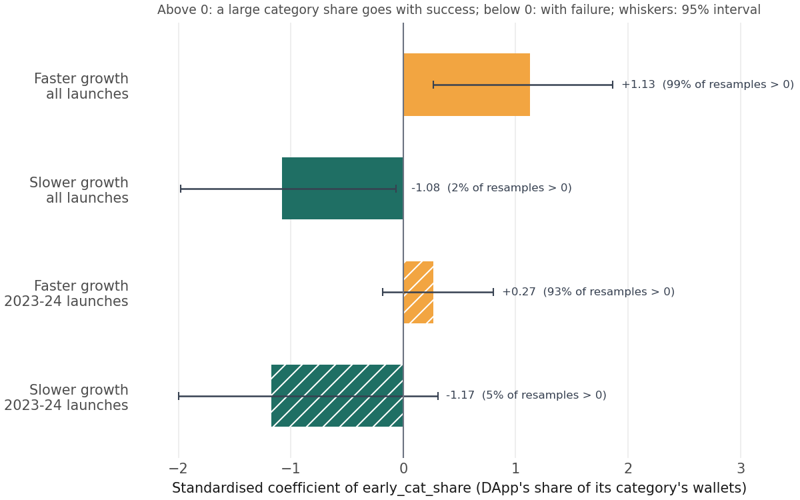

# Does what makes a DApp succeed change with the market?

**In short:** when the market grows slowly, early size counts for less, and a large share of the category is linked to failure instead of success; both still hold within the same years.

The definition of success stays the same throughout. What we compare is which feature groups matter most, measured as each group's share of all absolute coefficients. Each group of DApps is fitted with the team's L2 logistic regression on standardised features, with 1,000 resamples.

---

## 1. At Terra, early size counts for less; at Dencun, it stays low

**Size falls from 33% to 19% of the weight at Terra and stays at 19% at Dencun.**

  
  

- **Left:** Terra (2022-05) and Dencun (2024-03) cut the launches into three periods, each fitted on its own launches only.
  - **Periods:** 2020-01 to 2022-04 (232 DApps, 49 successful), 2022-05 to 2024-02 (174, 24) and 2024-03 to 2024-12 (106, 12).
  - **Why neighbouring periods:** comparing all launches on each side would mix the two events.
- **Right:** at Terra, size drops and stickiness rises; at Dencun, size stays low and context rises.
  - **How to read:** each panel compares the two periods next to one event; each line is one feature group's share of the weight.
  - **Terra:** size 33% → 19%, stickiness 17% → 33%, context 21% → 21%.
  - **Dencun:** size 19% → 19%, stickiness 33% → 32%, context 21% → 30%.
- **Event or market?** Two points in time cannot tell whether the shift comes from the events or from the market around them.

## 2. Grouped by market growth instead of date, the same shift appears

**When the market grows more slowly at launch, size falls from 27% to 19% of the weight.**

  
  

- **Left:** market growth is high in 2020–21 and low from 2022; its median splits the launches into faster and slower growth.
  - **Market growth:** `launch_eco_growth_3m`, the change in active wallets across all categories from 3 months earlier to the launch month. For April 2020 it compares April with January; 100% means twice as many wallets, 0% the same, below 0% fewer. Every DApp launched in the same month has the same value.
  - **Split:** above the median (26%), 228 DApps (48 successful); at or below it, 248 DApps (33). The 36 DApps launched before 2020-04 have no month 3 months earlier and are dropped.
  - **Why the median:** only 104 DApps (13 successful) launch into a shrinking market, too few to fit.
- **Right:** with slower growth, size counts for less and stickiness for more.
  - **How to read:** each feature group's share of the weight; solid bars use all launches, hatched bars 2023–24 alone (section 3). The split feature is left out of the fit.
  - **Solid bars:** size 27% with faster growth and 19% with slower; stickiness 22% and 32%.

## 3. Within the same years, size and category share still hold

**On 2023–24 launches alone, a large category share still goes with success in faster markets and with failure in slower ones (+0.27 vs −1.17).**

  
  

- **Left:** faster growth is mostly 2020–21 (162 of 228) and slower growth mostly 2022–24 (238 of 248), so only 2023–24 compares both in the same years.
  - **How to read:** DApps of each half launched in each year.
  - **2023–24 alone:** 66 faster-growth DApps (9 successful) and 171 slower (20), split at the same median.
- **Right:** category share flips with market growth, on all launches and within 2023–24.
  - **How to read:** the coefficient of `early_cat_share` (a DApp's share of its category's wallets) with its 95% interval.
  - **All launches:** +1.13 with faster growth (99% of resamples above 0) and −1.08 with slower (2%).
  - **2023–24:** +0.27 (93%) and −1.17 (5%).
- **Size and stickiness in 2023–24** (hatched bars in section 2): size still counts for less with slower growth (28% vs 17%), but stickiness no longer rises (36% vs 29%), so its rise looks like a change over time.

---

## Limitations

- **Small groups:** 9 successful DApps in the 2023–24 faster half and 12 after Dencun; intervals are wide and overlap.
- **Time is only partly removed:** within 2023–24 the faster half comes from 7 launch months and the slower half from 17.
- **Associations, not causes:** coefficients show what separates successful DApps from failed ones, not what the events or the market did to them.
- **Ethereum L1 only:** after Dencun, users moving to layer-2 networks look like a smaller L1 market.
