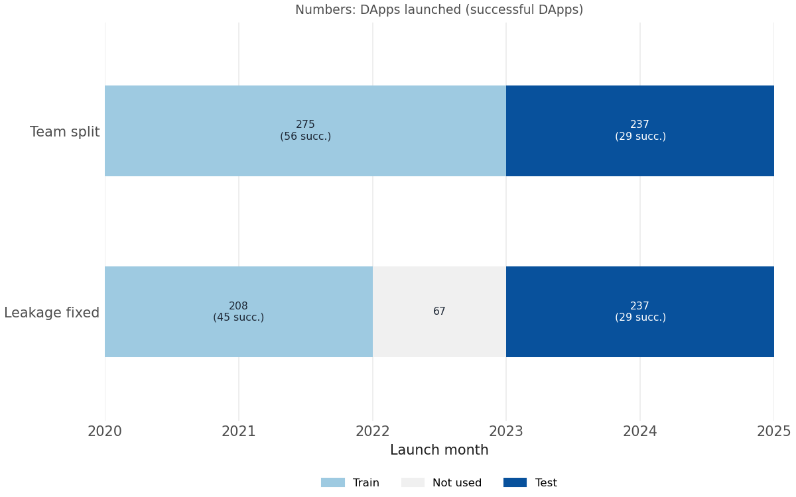
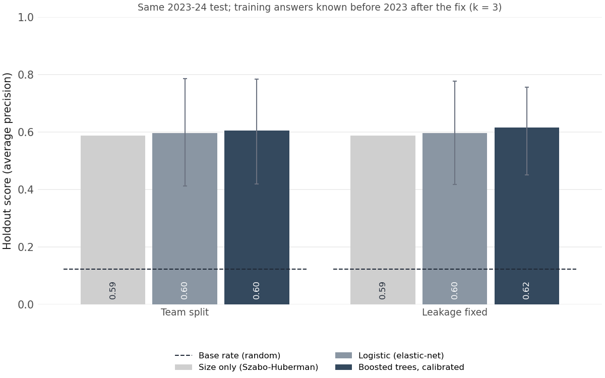
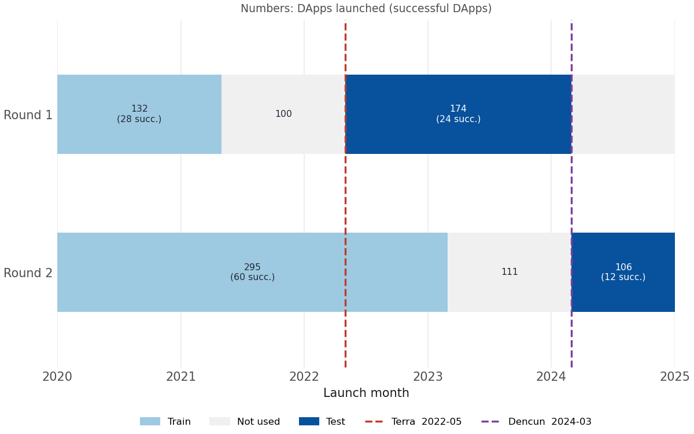
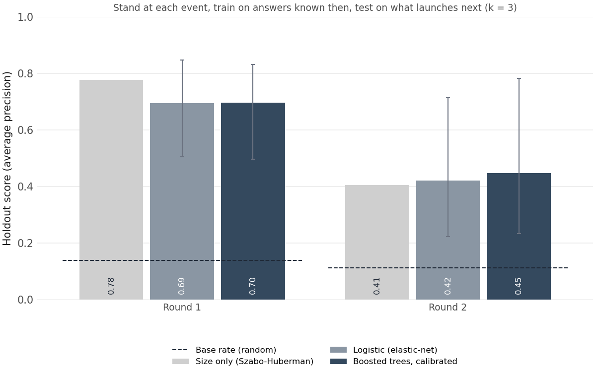
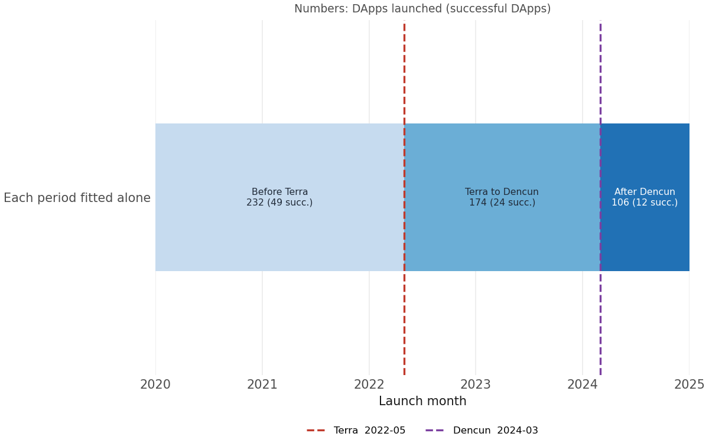
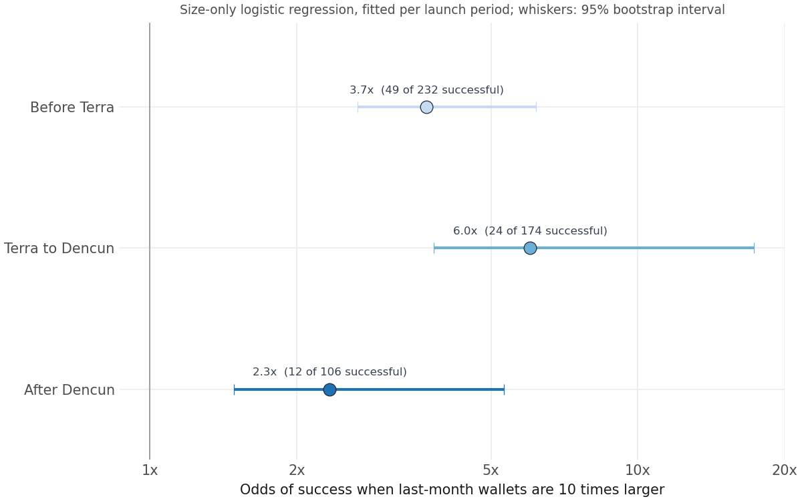

# Does the team model hold up over time?

**In short:** the team's score is fair, but it rests almost entirely on early size, and how much size tells changes with the market.

---

## 1. Fix the leakage first

**The team's split lets some training answers come from the test years; removing them barely changes the score.**

  
  

- **Leakage:** answers come 12 months after launch, so the 67 DApps launched in 2022 train on answers from 2023, inside the test.
- **Fix:** train only on launches up to 2021-12; the test is unchanged.
- **Little difference:** holdout average precision (AP) goes from 0.605 to 0.615 (random ranking scores the success rate, about 12%), so the team's 0.60 is not inflated and can stay the main score.

## 2. Split by two market events, and compare with size alone

**At both the Terra/UST collapse (2022-05) and the Dencun upgrade (2024-03), the full model never clearly beats size alone.**

  
  

- **Round 1, at Terra, is easy:** 0.70 against a 14% success rate, but size alone (Szabo–Huberman) does better, 0.78; the other 26 features only add noise.
- **Round 2, at Dencun, is harder:** 0.45 against 11%, with only 12 successful DApps; size alone drops to 0.41, and the other features add a little (+0.04).
- **Overall:** the 27 features barely beat size alone (+0.03 on the fixed split); they help only when size is weak.

## 3. Size effect in each period, fitted separately

**Fitted on each period alone, size matters most from Terra to Dencun and least after Dencun.**

  
  

- **Before Terra, 3.7x:** 10 times more early wallets raise the odds of success 3.7 times; early size already predicts well.
- **Terra to Dencun, 6.0x, strongest:** in the post-Terra bear market, success depends most on early size.
- **After Dencun, 2.3x, weakest:** early size says less, which helps explain why round 2 is harder; what takes over is in section 4.
- **Up, then down, not a steady trend:** size's weight moves with the market period; with three periods and overlapping intervals, it is a pattern to watch, not a proven change.

## 4. What drives success in each period

**Same definition of success, different rules behind it:** after Terra, new users replace size; after Dencun, use per wallet and fees join them. Details in [FEATURE_WEIGHTS.md](FEATURE_WEIGHTS.md).

---

## Limitations

- **Small tests:** 12–24 successful DApps per round, so intervals are wide; after Dencun has only 12, so round 2 and the feature weights should be rechecked as more data comes in.
